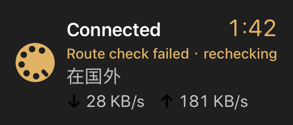
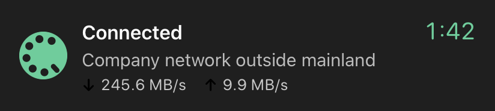
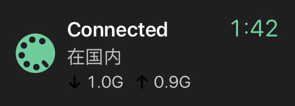

# 连接时间线与诊断报告（第一阶段）验收记录

计划见 [connection-diagnostics.md](../plans/connection-diagnostics.md)。本阶段**不改变**连接或自检
行为，只记录证据；任何耗时改善都要等真机基线回来后在第二阶段对比。

## 实现

- `appletv/XDialTV/ConnectionTimeline.swift`：App 与扩展共用的会话时间线。
  - App 与扩展在 App Group 的 `Diagnostics` 下分别原子写入 `connection-timeline-app.json` 和 `connection-timeline.json`，读取时按会话合并。扩展沿用旧文件，保留升级前的时间线和活动会话标记。
  - 最多 6 次会话、每次 120 个事件、文件不超过 256 KiB，超出时丢弃最旧的会话。
  - 文件损坏时重建，写入失败不影响连接。
- **关联 ID**：App 发起连接时生成，作为 `attemptID` 传给扩展。系统自行拉起隧道时由扩展生成，
  并标为当前活动会话，App 再挂到同一会话上。
- **App 端事件**：发起连接、配置生成（含规则预取）的耗时、启动包发出、系统状态的每次变化、
  启动看门狗。自检部分包括：开始（首次或补测）、因后台暂停或延后、每条线路试拨的耗时和结果码、
  路由计数前后、三个 HTTPS 请求各自的结果码和耗时、通过/未通过/超时、补测排程或预算用尽、
  用户断开、停止。
- **扩展端事件**：启动的每个阶段（距扩展启动的毫秒数）；线路试拨的排队时间、耗时和结果码；
  连接后的地区判断（耗时、结果码、地区码）；场景判断结论（是否读到 SSID、选中当前或其他场景）；
  场景切换开始/结束；停止原因。
- **结果码**：`ok / timeout / dns / connect / tls / http / cancelled / not-run / inconclusive / failed`。
  URLSession 错误按错误码归类，扩展返回的自由文本只提取固定关键词（如 `timeout`、`refused`、
  `dns-failed`、`http-503`），**原文不进时间线**，因为其中可能带有服务器名或解析后的地址。
- **诊断报告**（设置 → 诊断信息 → 分享）新增：版本与 build、系统版本、设备类型（iPhone/iPad）、
  当前场景、最近 3 次连接的完整时间线，时间相对各次会话开始。
- **脱敏**：
  - 时间线兜底去掉 URL 凭据、`password/token/cookie/...=` 的值、32 个字符以上的类令牌串、
    IPv4 与 IPv6 地址（以 `inet_pton` 校验，不会误伤时间）。
  - 报告再按配置中的服务器、账号、密码、SNI、订阅地址等原文替换。
  - 线路只显示用户起的名字；不含完整配置，也不含浏览记录。

## 验证

| 项目 | 结果 |
|---|---|
| `make ios`（App + 扩展，模拟器 SDK） | 通过，改动文件无新警告 |
| `make appletv`（tvOS App + 扩展） | 通过 |
| iOS 单元测试（独立模拟器 iPhone 18 Pro / iOS 27.3，`CODE_SIGNING_ALLOWED=NO`） | 88 个通过，含新增 `ConnectionTimelineTests` 9 个，覆盖：两个写入方共享会话与活动标记、会话与事件上限和轮转、损坏文件恢复、凭据/令牌/IP 去除、错误分类、关键词提取、报告渲染与报告脱敏 |
| `AppStateTests`、`ScenarioInTunnelSwitchTests` | 在这台未签名的模拟器上，**未修改的 main** 也同样崩溃或失败（钥匙串不可用，报“安全配置版本不一致”），与本改动无关；本次跳过，未当作通过 |

## 未做（需真机）

- 隧道无法在模拟器运行：App 与扩展**实际写入同一会话**、各阶段真实耗时、后台暂停时的事件，
  都还没有真机证据。
- 报告实际导出的样子，要等真机第一次分享时确认。
- 不改连接/自检行为，因此本阶段没有任何耗时“改善”可报告。

## 追加（2026-11-18）：锁屏实时活动排版与地区判断依据

### 现场反馈

锁屏横幅状态被截成“Connected,…”，网速的数值和“KB/s”被拆成两行，场景显示“在国外”。

**地区已确认正确，不是误判**：用户确认人在家，家里的上游路由器已经接入 XDVPN，网络出口本来
就在境外，因此“在国外”符合实际出口。手机端的 Direct 只是绕过 XDial 自己的隧道，并不会绕过
上游路由器的 VPN，也不代表物理位置。地区映射逻辑因此保持不变，也不按运营商或系统语言改判。
下文的地区改动只补充判断依据，并修复一个与这张截图无关的网络切换缺陷。

### 锁屏实时活动

- **原因**：黄卡状态下标题是“已连接，自检未通过 / Connected, check failed”，和计时、两组网速
  挤在同一行；网速的两段文字没有限制只占一行。
- **改法**（`ios/XDialShared/ConnectionActivityLockScreen.swift`，灵动岛展开时也一样）：
  - 标题只表示连接状态，计时不压缩。
  - 自检状态单独一行（琥珀色）。
  - 场景名单独一行，表示所选场景，不代表检测到的地区。
  - 两组网速各自作为整体占一行；放不下时改用紧凑写法（如 `1.0G`），不会折行。
  - 字号上限为 xxLarge，再大会挤掉行。
- **截图验证**：`ConnectionActivityLayoutTests` 在 300/345/365/412 pt 四种宽度、中英文、
  默认/xxLarge/AX3 三种字号、三档网速下共渲染 72 张，全部只有单行、高度在上限内。代表图：

  
  
  
  

- **未做**：真机锁屏和 iPhone Duo 竖向灵动岛的实际效果，待 TestFlight 版确认。

### 地区判断的依据

现状核查：

- **未连接时**：App 直连查询，禁止走 VPN 网卡，用系统 DNS。先查 Apple 地区服务，失败再查
  Cloudflare 的 trace，各等 2.5 秒。
- **已连接时**：扩展经 Direct 线路查询，域名由该线路的解析器解析。先查 Apple，失败再查 `1.1.1.1`，
  两次共用一个 8 秒期限。
- **映射规则**：地区码先按表找对应场景，表里没有的地区一律用 `*`（在国外）。
- **查询失败时**：**不会**选场景，保留之前的选择。已有测试和新增测试都确认未知地区不会落到 `*`。
- **网络切换**：扩展在应用结果前会核对网络签名，网络变了就作废这次结果。
- **发现的缺口**（代码审查发现，与本次截图无关）：App 端会复用正在进行的判断，**没有**检查网络
  是否变了，旧网络上测得的结果可能在切换网络后被应用。

改动：

- **Go**：新增 `ProbeOutboundCountryEvidence`，返回地区码、答复的服务（`apple-gcc` /
  `cloudflare-trace`）、每次失败的尝试（`服务:原因码`）和耗时；查询失败时也返回这些证据。
- **扩展**：
  - 判断记录写入：服务、先前失败、耗时，以及网络标识（网络签名加 SSID 的 SHA-256 前 6 位，
    不含网关地址和 Wi-Fi 名）。
  - 时间线记录 `region_probe`（路径、网络标识、服务、结果）；网络或目录变化导致作废时，记录
    `scenario_decision_discarded`。
- **App**：
  - 查询改用带证据的版本。
  - 判断带上网络代际：网络变了之后不再复用旧的判断；旧判断完成后会被丢弃，不覆盖新的结果，
    并在诊断里写明“查询期间网络变了，结果作废”。
- **诊断报告**：
  - “自动选场景”一行带上依据：服务、先前失败、耗时、网络标识、多少秒前。
  - “当前所选场景（不是地区检测结果）”单独一行。
- **测试**：`ScenarioAutoPilotTests` 新增 3 个用例，覆盖网络变化后旧判断作废、证据写入诊断并可
  编解码、未知地区不会落到 `*`；Go 新增一个用例，确认查询失败时仍返回证据。

### 本次回归

| 项目 | 结果 |
|---|---|
| iOS 单元测试（同一台独立模拟器，跳过两组环境问题套件） | 93 个通过 |
| `make ios`、`make appletv` | 通过 |
| `make test-macos-transaction`（`apple/Home` 也被 macOS 编译） | 927 个 XCTest 通过 |
| `make go-vet`、`make test` | 通过 |

## PR #27 第三轮审查（2026-11-18）

本轮保持原目标：连接时间线、请求耗时与失败分类；锁屏排版和地区依据是已明确追加的
现场需求。新增行数主要来自这些展示/证据及其测试。本轮不添加快照缓存、轮询、锁或重试；
缩减同步读取与重复的 App 会话计时状态，复用既有串行队列。

### 不变量与事件边界

| 事件 | 会话归属/完成点 |
|---|---|
| 手动启动尚未完成或系统还在 connecting | 保留 App 启动尝试的 ID，不被上一条活跃记录替换 |
| 接管已运行连接、前台恢复、自检和用户操作 | 在后台追加时读取扩展拥有的 activeSessionID，覆盖 App 挂起期间遗漏的系统重连 |
| stopped + endActiveSession | 同一串行队列先尝试写 stopped/清除当前标记，再执行系统 stop completion；既有引擎停止看门狗保留 |
| 文件锁繁忙/失败 | 不无限等待、不无锁写入；诊断可丢弃，连接和界面不等锁；报告不是完整审计日志 |
| 导出报告 | 异步在既有队列读取，界面只显示返回的值，不在主线程等磁盘/队列 |
| 一个并发请求结束 | 当时保存 completedAt；其它请求迟到时不重盖所有请求的时间戳 |

App 不再存储另一份“当前会话起始 uptime”来计算状态/停止耗时；报告统一按持久会话
startedAt 与事件 t 对齐。明确的单步耗时继续由该步自己测量。

新增 4 个测试分别覆盖遗漏 disconnected 后的新会话、停止回调落在末尾记录之后、
实际持锁时不等待/不无锁覆盖，以及延迟追加仍保留请求完成顺序。

CI 的 `TestEngineDNSSelfHealPicksUpLeftoverState` 一次失败发生在“DNS 已还原、状态文件
尚未删除”的观察窗口：失败日志的断言先于 `system DNS restored`。本 PR 对 `core/engine`
无改动；干净主线 checkout 的同一测试连续 300 次通过，工作分支连续 30 次通过。
仅重跑该次失败 CI 一次，不在诊断 PR 修改 DNS 自愈实现或缩短/放宽超时。

本轮未修改 Go/libbox；沿用已重建的 iOS framework，不冒称新增 Go 构建证据。
原先 unsigned 环境在主线同样失败的 AppStateTests/ScenarioInTunnelSwitchTests 仍排除。
日志在 `build/pr-follow/`，验证结果以下一段最终收据为准。

### 本轮最终收据

- `ios-tests-final.log`：同一独立模拟器运行 iOS XCTest，97 项、0 失败，仍明确排除上述两组已知环境套件。
- `mobile-builds-final.log`：`make ios appletv` 最终均成功。
- `timeline-tests.log`：新增会话/锁争用/停止/时间戳测试先定向通过；最终全量已包括这些测试。
- `dns-current.log` / `dns-baseline.log`：分别为当前分支 30 次和干净主线同代码 300 次窄测试，均通过。
- `gate.log`：public-content gate 通过。未改 macOS 行为，也未重启宿主当前连接。
- 未新增实机、自检真实耗时对照或 TestFlight 可下载证据；仍需合入后的既有上传流程和第 7 节实测清单。

## 长连接断线诊断（2026-11-19）

- 每次会话保留开头 30 条记录，剩余 90 个位置随新事件滚动。App 请求停止、引擎断开、系统停止原因和首次连上的时间随会话单独保存。
- 地区探测和场景判断合为一条记录。连续相同的判断保留首次时间、末次时间、次数和最近一次判断耗时。首次和变化立即排队写入；连续重复时每分钟汇总，扩展遇到其他事件或正常结束时提前写入。扩展突然退出时，末次汇总之后的重复样本可能丢失。
- 分享文本把上次连接的结束证据与本次启动来源放在时间线前面。没有停止回调时显示最后记录时间和“停止原因未知”。旧版文件仍可读取。
- iOS 模拟器验收覆盖 2000 次连续相同判断、网络变化、DNS 失败与恢复、长连接尾部滚动，以及跨会话的停止原因和启动来源。
