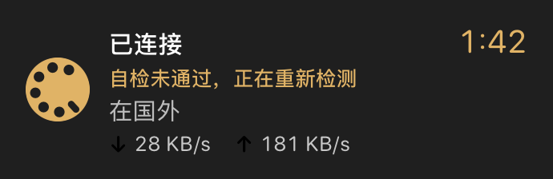

# 连接时间线与诊断报告（第一阶段）验收记录

计划见 [connection-diagnostics.md](../plans/connection-diagnostics.md)。本阶段**不改变**连接或自检
行为，只记录证据；任何耗时改善都要等真机基线回来后在第二阶段对比。

## 实现

- `appletv/XDialTV/ConnectionTimeline.swift`：App 与扩展共用的会话时间线。
  - 存放在 App Group 的 `Diagnostics/connection-timeline.json`；进程内用串行队列，跨进程用 `flock`。
  - 最多 6 次会话、每次 120 个事件、文件不超过 256 KiB，超出时丢弃最旧的会话。
  - 文件损坏时重建，写入失败不影响连接。
- **关联 ID**：App 发起连接时生成，作为 `attemptID` 传给扩展。系统自行拉起隧道时由扩展生成，
  并标为当前活动会话，App 再挂到同一会话上。
- **App 端事件**：发起连接、配置生成（含规则预取）的耗时、启动包发出、系统状态的每次变化、
  启动看门狗。自检部分包括：开始（首次或补测）、因后台暂停或延后、每条线路试拨的耗时和结果码、
  路由计数前后、三个 HTTPS 请求各自的结果码和耗时、通过/未通过/超时、补测排程或预算用尽、
  用户断开、停止。
- **扩展端事件**：启动的每个阶段（距扩展启动的毫秒数）；线路试拨的排队时间、耗时和结果码；
  连接后的地区判断（耗时、结果码、地区码）；场景判断结论（是否读到 SSID、选中当前或其他场景）；
  场景切换开始/结束；停止原因。
- **结果码**：`ok / timeout / dns / connect / tls / http / cancelled / not-run / inconclusive / failed`。
  URLSession 错误按错误码归类，扩展返回的自由文本只提取固定关键词（如 `timeout`、`refused`、
  `dns-failed`、`http-503`），**原文不进时间线**，因为其中可能带有服务器名或解析后的地址。
- **诊断报告**（设置 → 诊断信息 → 分享）新增：版本与 build、系统版本、设备类型（iPhone/iPad）、
  当前场景、最近 3 次连接的完整时间线，时间相对各次会话开始。
- **脱敏**：
  - 时间线兜底去掉 URL 凭据、`password/token/cookie/...=` 的值、32 个字符以上的类令牌串、
    IPv4 与 IPv6 地址（以 `inet_pton` 校验，不会误伤时间）。
  - 报告再按配置中的服务器、账号、密码、SNI、订阅地址等原文替换。
  - 线路只显示用户起的名字；不含完整配置，也不含浏览记录。

## 验证

| 项目 | 结果 |
|---|---|
| `make ios`（App + 扩展，模拟器 SDK） | 通过，改动文件无新警告 |
| `make appletv`（tvOS App + 扩展） | 通过 |
| iOS 单元测试（独立模拟器 iPhone 18 Pro / iOS 27.3，`CODE_SIGNING_ALLOWED=NO`） | 88 个通过，含新增 `ConnectionTimelineTests` 9 个，覆盖：两个写入方共享会话与活动标记、会话与事件上限和轮转、损坏文件恢复、凭据/令牌/IP 去除、错误分类、关键词提取、报告渲染与报告脱敏 |
| `AppStateTests`、`ScenarioInTunnelSwitchTests` | 在这台未签名的模拟器上，**未修改的 main** 也同样崩溃或失败（钥匙串不可用，报“安全配置版本不一致”），与本改动无关；本次跳过，未当作通过 |

## 未做（需真机）

- 隧道无法在模拟器运行：App 与扩展**实际写入同一会话**、各阶段真实耗时、后台暂停时的事件，
  都还没有真机证据。
- 报告实际导出的样子，要等真机第一次分享时确认。
- 不改连接/自检行为，因此本阶段没有任何耗时“改善”可报告。

## 追加（2026-11-18）：锁屏实时活动排版与地区判断依据

### 现场反馈

锁屏横幅状态被截成“Connected,…”，网速的数值和“KB/s”被拆成两行，场景显示“在国外”。
运营商名称和系统语言都不能说明真实出口在哪里；这里没有据此判断，也没有先认定是 VPN 出口
污染或旧状态造成的。

### 锁屏实时活动

- **原因**：黄卡状态下标题是“已连接，自检未通过 / Connected, check failed”，和计时、两组网速
  挤在同一行；网速的两段文字没有限制只占一行。
- **改法**（`ios/XDialShared/ConnectionActivityLockScreen.swift`，灵动岛展开时也一样）：
  - 标题只表示连接状态，计时不压缩。
  - 自检状态单独一行（琥珀色）。
  - 场景名单独一行，表示所选场景，不代表检测到的地区。
  - 两组网速各自作为整体占一行；放不下时改用紧凑写法（如 `1.0G`），不会折行。
  - 字号上限为 xxLarge，再大会挤掉行。
- **截图验证**：`ConnectionActivityLayoutTests` 在 300/345/365/412 pt 四种宽度、中英文、
  默认/xxLarge/AX3 三种字号、三档网速下共渲染 72 张，全部只有单行、高度在上限内。代表图：

  
  
  
  

- **未做**：真机锁屏和 iPhone Duo 竖向灵动岛的实际效果，待 TestFlight 版确认。

### 地区判断的依据

现状核查：

- **未连接时**：App 直连查询，禁止走 VPN 网卡，用系统 DNS。先查 Apple 地区服务，失败再查
  Cloudflare 的 trace，各等 2.5 秒。
- **已连接时**：扩展经 Direct 线路查询，域名由该线路的解析器解析。先查 Apple，失败再查 `1.1.1.1`，
  两次共用一个 8 秒期限。
- **映射规则**：地区码先按表找对应场景，表里没有的地区一律用 `*`（在国外）。
- **查询失败时**：**不会**选场景，保留之前的选择。已有测试和新增测试都确认未知地区不会落到 `*`。
- **网络切换**：扩展在应用结果前会核对网络签名，网络变了就作废这次结果。
- **发现的缺口**：App 端会复用正在进行的判断，**没有**检查网络是否变了，旧网络上测得的结果
  可能在切换网络后被应用。

改动：

- **Go**：新增 `ProbeOutboundCountryEvidence`，返回地区码、答复的服务（`apple-gcc` /
  `cloudflare-trace`）、每次失败的尝试（`服务:原因码`）和耗时；查询失败时也返回这些证据。
- **扩展**：
  - 判断记录写入：服务、先前失败、耗时，以及网络标识（网络签名加 SSID 的 SHA-256 前 6 位，
    不含网关地址和 Wi-Fi 名）。
  - 时间线记录 `region_probe`（路径、网络标识、服务、结果）；网络或目录变化导致作废时，记录
    `scenario_decision_discarded`。
- **App**：
  - 查询改用带证据的版本。
  - 判断带上网络代际：网络变了之后不再复用旧的判断；旧判断完成后会被丢弃，不覆盖新的结果，
    并在诊断里写明“查询期间网络变了，结果作废”。
- **诊断报告**：
  - “自动选场景”一行带上依据：服务、先前失败、耗时、网络标识、多少秒前。
  - “当前所选场景（不是地区检测结果）”单独一行。
- **测试**：`ScenarioAutoPilotTests` 新增 3 个用例，覆盖网络变化后旧判断作废、证据写入诊断并可
  编解码、未知地区不会落到 `*`；Go 新增一个用例，确认查询失败时仍返回证据。

### 本次回归

| 项目 | 结果 |
|---|---|
| iOS 单元测试（同一台独立模拟器，跳过两组环境问题套件） | 93 个通过 |
| `make ios`、`make appletv` | 通过 |
| `make test-macos-transaction`（`apple/Home` 也被 macOS 编译） | 927 个 XCTest 通过 |
| `make go-vet`、`make test` | 通过 |
