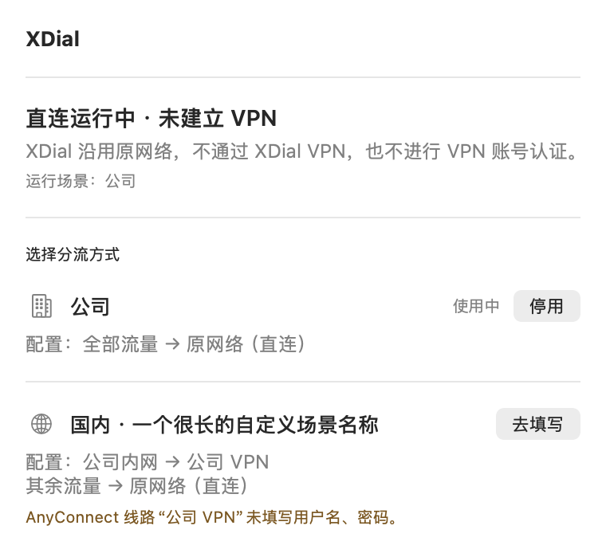
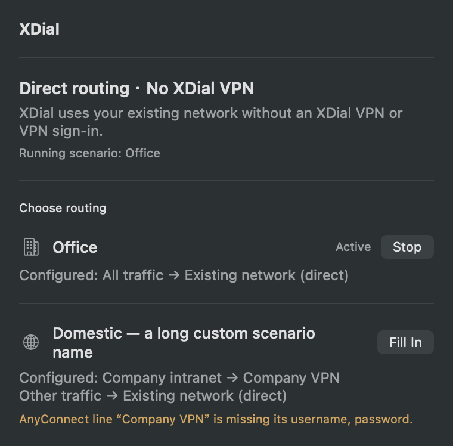

# 场景与连接状态

这些图片由 `ScenarioConnectionViewsTests` 使用实际 SwiftUI 组件和虚构配置离屏渲染，
展示状态区与场景行，不是完整菜单弹窗或已建立真实 VPN 的截图。

| 中文 / 浅色 | English / Dark |
| --- | --- |
|  |  |

用户选择的是分流配置；只有已提交的运行报告才能说明线路是否就绪。
“公司”这类自定义名称可以保留，但不再作为判断 VPN 连接的依据。
在海外也无需猜测地域标签：直接查看规则去向并启用需要的场景。

验收覆盖：纯直连、VPN、未知线路类型、失败/未提交事务、切换期间旧场景、
未启用时的过期报告、缺少 AnyConnect 凭据、中英文及长名称布局。
截图测试会在 xcresult 中保留四种语言/外观组合。
